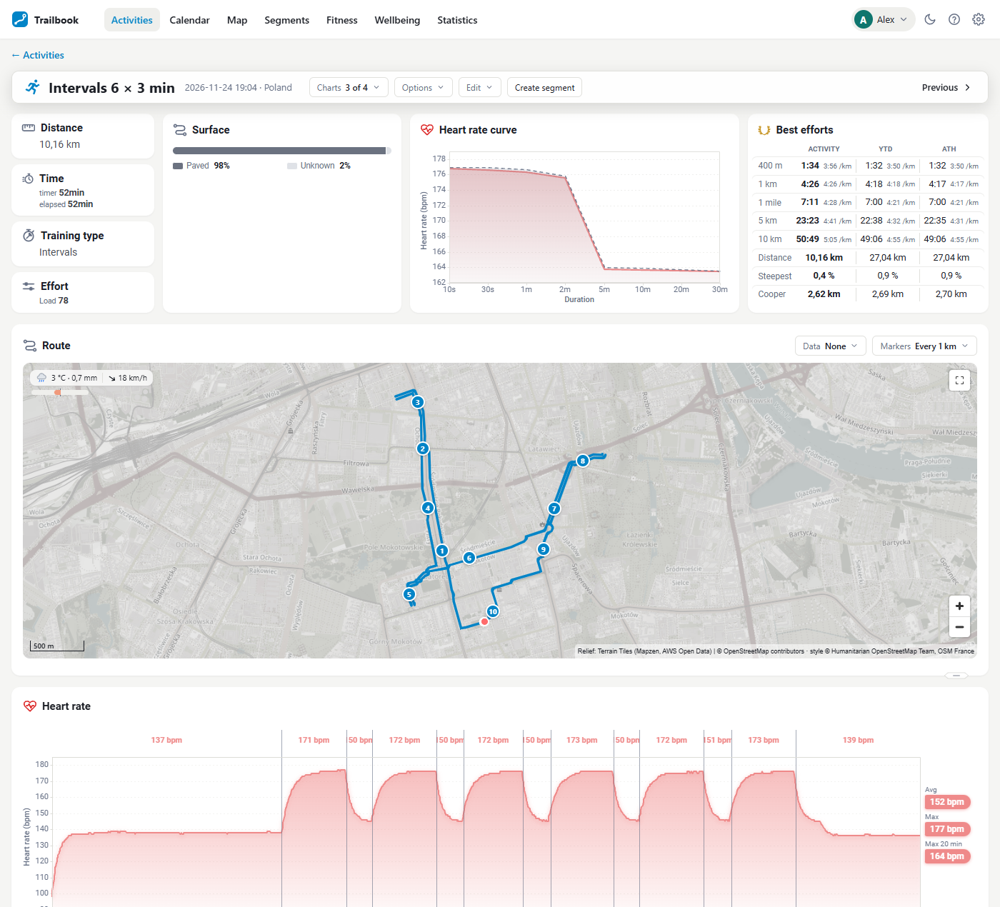
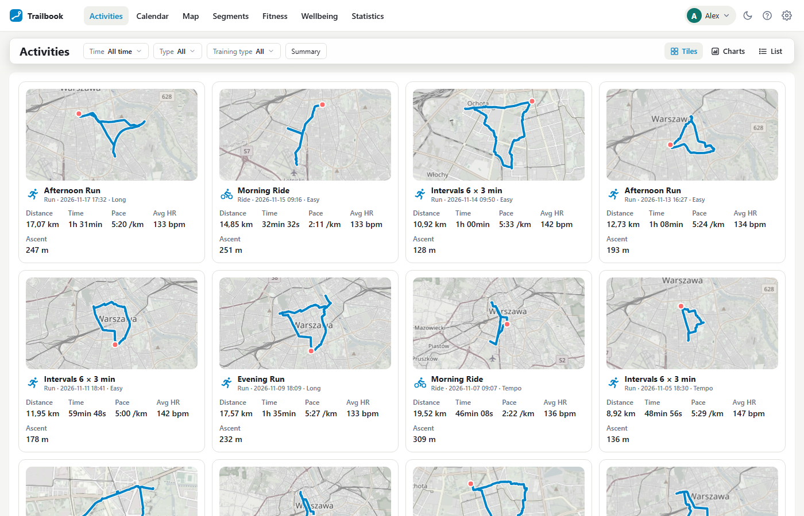

# Trailbook — extended sports and fitness statistics for Garmin

**Your Garmin training log, at home.** Trailbook is a Home Assistant add-on built around
Garmin Connect: connect your account once and every activity you have ever recorded — and
every new one — lands in Home Assistant as maps, charts and statistics. Everything runs on
your own Home Assistant box, even a small one like the Home Assistant Yellow, and your data
never leaves it.

Trailbook gets the most out of a Garmin watch or bike computer. Other sources (a Strava
export, FIT/GPX/TCX files) are there to bring in older history or a second device.

> Trailbook is an independent open-source project, not affiliated with or endorsed by Garmin.
> Data marked as Garmin's (training effect, Body Battery, stamina…) comes from Garmin devices
> and Garmin Connect. See [Trademarks](#trademarks).




> [!NOTE]
> Trailbook is young and changes quickly. It already covers a lot (see below), the look is a
> working preview and the final design is still to come. Parts marked 🚧 are being built.

## Features

### Activities
- One list of everything, as tiles or a table: filter by sport, type, date and distance,
  sort by any column.
- 100+ activity types in sport groups (running, cycling, swimming, hiking, winter sports,
  water sports, gym…), each with its own icon. The type can be changed per activity.
- Training type of every run and ride (easy, tempo, intervals, long, race…), detected from
  heart rate and pace and changeable by hand.

### Activity page
- Route map coloured by pace, heart rate, power, altitude or gradient, with kilometre
  markers, weather at the start and road surface (asphalt, gravel, trail…).
- Charts of heart rate, pace/speed, power, cadence, altitude and more, with interval and
  climb sections drawn in and editable.
- Laps, best efforts, heart rate and power zones, power curve, gear used.



### Map
- Every route on one map with a heatmap effect.
- Explorer tiles: all map squares you have visited, your biggest square and cluster.


### Segments
- Create segments from an activity or by drawing on the map; every activity that passes
  through is matched automatically, with a leaderboard of your efforts.

### Fitness and statistics
- Training load of every activity, and fitness, fatigue and form over time.
- Records and best efforts (fastest 5 km, best 20 min power…) with their curves.
- Years compared: distance, activities, elevation and time per week or month, each year a
  line, with running totals; explorer tiles of every size over time; a calendar of your training.
- Compare people side by side.


### People
- Several people in one install, each with their own activities, heart rate and power
  thresholds (with the date they changed) and settings.

### Garmin Connect — the main source
- Connect with your personal Garmin Connect API key: the whole history is downloaded once,
  then new activities arrive automatically.
- You get everything your Garmin recorded: the original FIT files with all their data
  (heart rate, power, running dynamics, laps, workout steps, the thresholds your watch used),
  plus what only Garmin Connect knows — activity titles, the place, training effect, Garmin's
  training load and Body Battery change.
- 🚧 Coming next from Garmin: sleep, stress, HRV, resting heart rate, steps and weight.

### Other sources — for older history
- **Strava** — upload the export ZIP (titles, descriptions and activities entered by hand
  come with it) or single files; handy for the years before your Garmin.
- **A folder** — FIT, GPX and TCX files (also `.gz`) saved to a folder, for example by a
  Home Assistant automation; one subfolder per person, or the watch decides.
- **Upload** — a Garmin export ZIP or single files.
- Activities you already have are recognised and skipped, whatever the source.

### Backup and moving
- One-click export of everything (database, settings and all files) to a single ZIP, and
  restore on a new device. The add-on is also part of Home Assistant backups.

### Light on resources
- Near-zero CPU when idle; imports run in the background at the lowest priority.
- CPU and memory go up only while activities are being added and while the road surface is
  looked up for them. You notice it only when a large batch comes in at once (the first
  Garmin download, a Strava export); everyday syncing stays in the background.


## Installation

Two ways to run Trailbook, the same app in both:

- **Home Assistant add-on** (recommended) — for Home Assistant OS and Supervised installs.
- **Docker** — for everyone else: no Home Assistant at all, or Home Assistant Container / Core,
  which have no add-ons. See [Without Home Assistant](#without-home-assistant-docker).

[](https://my.home-assistant.io/redirect/supervisor_add_addon_repository/?repository_url=https%3A%2F%2Fgithub.com%2FMD0005%2FTrailbook)

Or by hand:

1. In Home Assistant open **Settings › Add-ons › Add-on store**.
2. Click **⋮ › Repositories**, paste `https://github.com/MD0005/Trailbook` and click **Add**.
3. Find **Trailbook** in the store and click **Install**.
4. Click **Start**, then **Open web UI** (or turn on *Show in sidebar*).

### Without Home Assistant (Docker)

The same image runs on any machine with Docker (amd64 or arm64, e.g. a Raspberry Pi or a NAS).
Download [`docker-compose.yml`](docker-compose.yml), put a password next to it and start:

```bash
echo "TRAILBOOK_PASSWORD=pick-a-password" > .env
docker compose up -d                       # then open http://<this machine>:8099
```

The database lives in `./data`; put FIT files in `./share/trailbook` and choose
`/share/trailbook` as the watched folder. Exports land in `./share/trailbook-exports`.
Update with `docker compose pull && docker compose up -d`. Log out at `/logout`.
The compose file does not start without `TRAILBOOK_PASSWORD`; with a plain `docker run` and no
password there is no login at all, so leave it out only if nobody else can reach the port.
Home Assistant notifications and the records sensor are not available outside the add-on.

## First steps

1. **Settings › People** — add the people whose training you keep.
2. **Settings › Data** — choose **Garmin Connect** (recommended) and paste each person's
   personal API key. Old history from Strava goes in under *Other sources*.
3. Wait for the first import; progress is shown in **Settings › Imported**.
4. **Settings › People** — check the heart rate and power thresholds; training load and
   zones depend on them.

The watched folder must be inside a folder the add-on can see: `/share` (for example
`/share/trailbook`), `/media` (read only) or the add-on's own config folder.

## Records in Home Assistant

When a new activity sets a record, the add-on tells Home Assistant through one sensor,
`sensor.trailbook_records`. A record is a top-3 place of all time or of this year: the best
efforts of runs and rides (fastest 5 km, best 20 min power…), the longest distance and your
segments. Only activities from the last 14 days count, so importing old history never fires.

- Each new record is **one new state** of the sensor: the state is the record's id, `0` means
  "no new record". Each record is sent once.
- The attributes carry a ready notification: `title` (e.g. `ALL-TIME RECORD`, `2026 2ND BEST`),
  `message` (who, what, the result and the result it beat), `icon` (`mdi:trophy`,
  `mdi:medal`…) and `color`, plus the details (`person`, `activity_id`, `scope`, `rank`…).
- After a Home Assistant restart the sensor comes back as `0`, so a record is always a change
  from a number — the condition below makes sure nothing is announced twice.

Example: a notification for every new record.

```yaml
alias: Trailbook - record notification
triggers:
  - trigger: state
    entity_id: sensor.trailbook_records
    not_from: [unavailable, unknown]
    not_to: [unavailable, unknown, "0"]
conditions:
  # only a change from a number (0 or the previous record), never the sensor appearing
  - condition: template
    value_template: >-
      {{ trigger.from_state is not none and is_number(trigger.from_state.state) }}
actions:
  - action: persistent_notification.create  # or notify.mobile_app_<your phone>
    data:
      title: "{{ trigger.to_state.attributes.title }}"
      message: "{{ trigger.to_state.attributes.message }}"
mode: queued
max: 30
```

## Updating

Home Assistant shows when a new version is out (**Settings › Add-ons › Trailbook**); the
update dialog lists what changed ([changelog](trailbook/CHANGELOG.md)).
The database is upgraded on start. An older version cannot open a database a newer one has
upgraded, so tick *Create backup* in the update dialog if you may want to go back.

## Privacy

Your activities, routes and health data stay in Home Assistant. Trailbook only talks to the
internet for:

- map tiles from OpenStreetMap,
- weather for an activity's time and place (Open-Meteo),
- road surface along a route (OpenStreetMap Overpass),
- Garmin Connect, when you connect an account.

## In development 🚧

- 🚧 **New design** — the current look is a technical preview.
- 🚧 **Polish translation** of the interface.
- 🚧 **Wellbeing** — sleep, stress, HRV, resting heart rate, steps and weight from Garmin
  Connect.
- 🚧 **More sources** — further services under *Settings › Other sources*.
- 🚧 **Home Assistant automations** — start an import from an automation.

## Development

Trailbook runs on a PC without Home Assistant:

```bash
python -m venv .venv
.venv/Scripts/python -m pip install -e "backend[dev]"   # Linux/macOS: .venv/bin/...
.venv/Scripts/trailbook serve --root sample-data        # http://127.0.0.1:8099
```

Tests: `cd backend && ../.venv/Scripts/python -m pytest`. How it is built:
[specification](docs/SPEC.md); how the numbers are calculated: [manual](docs/MANUAL.md).

## Trademarks

Garmin, Garmin Connect, Body Battery and Training Effect are trademarks of Garmin Ltd. or its
subsidiaries. Strava, Home Assistant, OpenStreetMap and other names are trademarks of their
owners. They are used here only to say what Trailbook works with; Trailbook is not affiliated
with, sponsored or endorsed by any of them.

## License

[MIT](LICENSE).
Screenshots show generated demo data.
