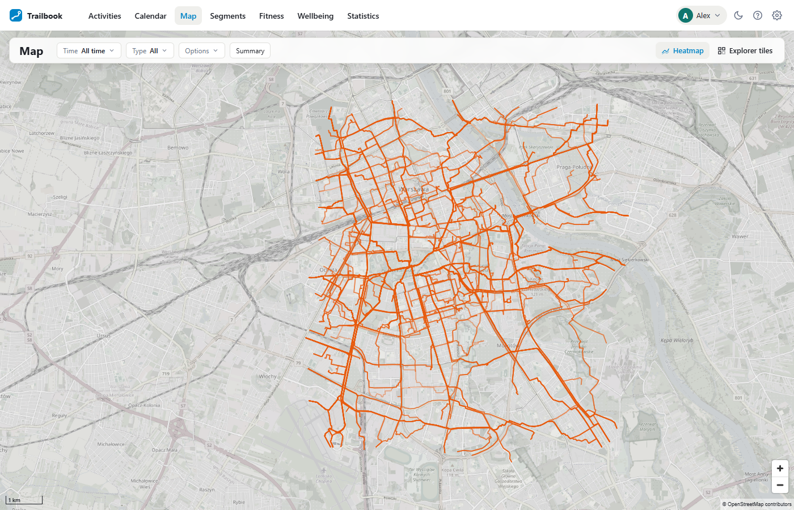
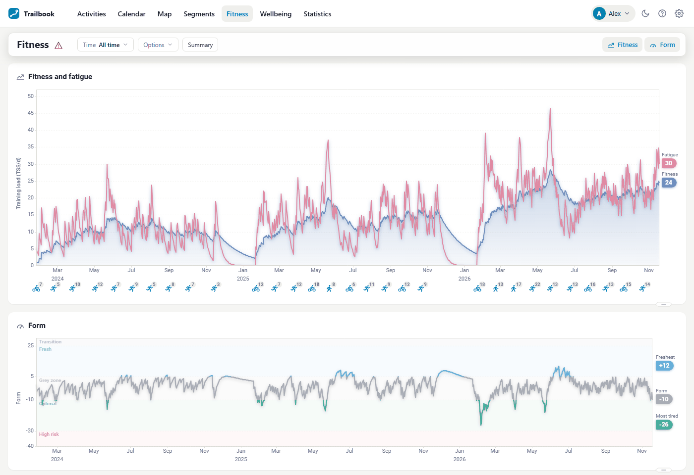
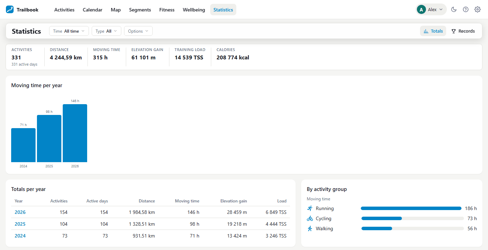
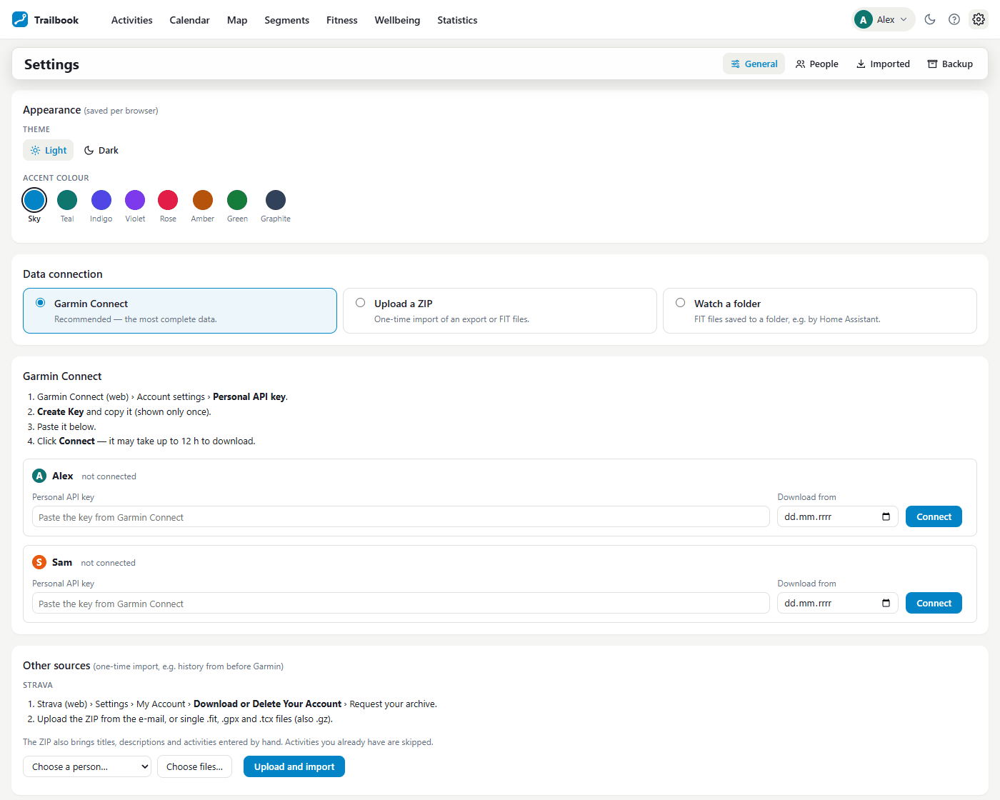

# Trailbook

**Your training log, at home.** Trailbook is a Home Assistant add-on that keeps every
workout you have ever recorded — from Garmin Connect, a Strava export or plain FIT/GPX
files — and turns it into maps, charts and statistics. Everything runs on your own Home
Assistant box, even a small one like the Home Assistant Yellow, and your data never leaves it.


> [!NOTE]
> Trailbook is young and changes quickly. It already covers a lot (see below), the look is a
> working preview and the final design is still to come. Parts marked 🚧 are being built.

## Features

### Activities
- One list of everything, as tiles or a table: filter by sport, type, date and distance,
  sort by any column.
- 100+ activity types in sport groups (running, cycling, swimming, hiking, winter sports,
  water sports, gym…), each with its own icon. The type can be changed per activity.
- Training type of every run and ride (easy, tempo, intervals, long, race…), detected from
  heart rate and pace and changeable by hand.

### Activity page
- Route map coloured by pace, heart rate, power, altitude or gradient, with kilometre
  markers, weather at the start and road surface (asphalt, gravel, trail…).
- Charts of heart rate, pace/speed, power, cadence, altitude and more, with interval and
  climb sections drawn in and editable.
- Laps, best efforts, heart rate and power zones, power curve, gear used.


### Map
- Every route on one map with a heatmap effect.
- Explorer tiles: all map squares you have visited, your biggest square and cluster.



### Segments
- Create segments from an activity or by drawing on the map; every activity that passes
  through is matched automatically, with a leaderboard of your efforts.

### Fitness and statistics
- Training load of every activity, and fitness, fatigue and form over time.
- Records and best efforts (fastest 5 km, best 20 min power…) with their curves.
- Totals per week, month and year and per sport; a calendar of your training.
- Compare people side by side.





### People
- Several people in one install, each with their own activities, heart rate and power
  thresholds (with the date they changed) and settings.

### Getting your data in
- **Garmin Connect** — connect with your personal API key; the whole history is downloaded
  once and new activities arrive automatically.
- **Strava** — upload the export ZIP (titles, descriptions and activities entered by hand
  come with it) or single files. Activities you already have are skipped.
- **A folder** — FIT, GPX and TCX files (also `.gz`) saved to a folder, for example by a
  Home Assistant automation; one subfolder per person, or the watch decides.
- **Upload** — a Garmin export ZIP or single files.
- Duplicates are recognised across all sources.

### Backup and moving
- One-click export of everything (database, settings and all files) to a single ZIP, and
  restore on a new device. The add-on is also part of Home Assistant backups.

### Light on resources
- Near-zero CPU when idle; imports run in the background at the lowest priority.



## Installation

[](https://my.home-assistant.io/redirect/supervisor_add_addon_repository/?repository_url=https%3A%2F%2Fgithub.com%2FMD0005%2FTrailbook)

Or by hand:

1. In Home Assistant open **Settings › Add-ons › Add-on store**.
2. Click **⋮ › Repositories**, paste `https://github.com/MD0005/Trailbook` and click **Add**.
3. Find **Trailbook** in the store and click **Install**.
4. Click **Start**, then **Open web UI** (or turn on *Show in sidebar*).

## First steps

1. **Settings › People** — add the people whose training you keep.
2. **Settings › General** — choose where activities come from: Garmin Connect, a folder or
   an upload. Old history from Strava goes in under *Other sources*.
3. Wait for the first import; progress is shown in **Settings › Imported**.
4. **Settings › People** — check the heart rate and power thresholds; training load and
   zones depend on them.

The watched folder must be inside a folder the add-on can see: `/share` (for example
`/share/trailbook`), `/media` (read only) or the add-on's own config folder.

## Updating

Home Assistant shows when a new version is out (**Settings › Add-ons › Trailbook**).
The database is upgraded on start. An older version cannot open a database a newer one has
upgraded, so tick *Create backup* in the update dialog if you may want to go back.

## Privacy

Your activities, routes and health data stay in Home Assistant. Trailbook only talks to the
internet for:

- map tiles from OpenStreetMap,
- weather for an activity's time and place (Open-Meteo),
- road surface along a route (OpenStreetMap Overpass),
- Garmin Connect, when you connect an account.

## In development 🚧

- 🚧 **New design** — the current look is a technical preview.
- 🚧 **Polish translation** of the interface.
- 🚧 **Wellbeing** — sleep, stress, HRV, resting heart rate, steps and weight from Garmin
  Connect.
- 🚧 **More sources** — further services under *Settings › Other sources*.
- 🚧 **Home Assistant automations** — start an import from an automation.

## Development

Trailbook runs on a PC without Home Assistant:

```bash
python -m venv .venv
.venv/Scripts/python -m pip install -e "backend[dev]"   # Linux/macOS: .venv/bin/...
.venv/Scripts/trailbook serve --root sample-data        # http://127.0.0.1:8099
```

Tests: `cd backend && ../.venv/Scripts/python -m pytest`. How it is built:
[specification](docs/SPEC.md); how the numbers are calculated: [manual](docs/MANUAL.md).

## License

[MIT](LICENSE).
Screenshots show generated demo data.
