# Trailbook — extended sports and fitness statistics for Garmin

**Your Garmin training log, at home.** Trailbook is a Home Assistant app (formerly add-on)
built around Garmin Connect: connect your account once and every activity you have ever recorded — and
every new one — lands in Home Assistant as maps, charts and statistics. Everything runs on
your own Home Assistant box, even a small one like the Home Assistant Yellow, and your data
never leaves it.

Trailbook gets the most out of a Garmin watch or bike computer. Other sources (a Strava
export, FIT/GPX/TCX files) are there to bring in older history or a second device.

> Trailbook is an independent open-source project, not affiliated with or endorsed by Garmin.
> Data marked as Garmin's (training effect, Body Battery, stamina…) comes from Garmin devices
> and Garmin Connect. See [Trademarks](#trademarks).


## Contents

- [Features](#features)
- [Installation](#installation)
  - [Home Assistant app](#home-assistant-app)
  - [Windows app](#windows-app)
  - [Docker](#docker)
- [First steps](#first-steps)
- [Records in Home Assistant](#records-in-home-assistant)
- [Updating](#updating)
- [Privacy](#privacy)
- [In development](#in-development)
- [Development](#development)
- [Support](#support)
- [Trademarks](#trademarks)
- [License](#license)

<p align="center"><a href="docs/screenshots/activity.webp">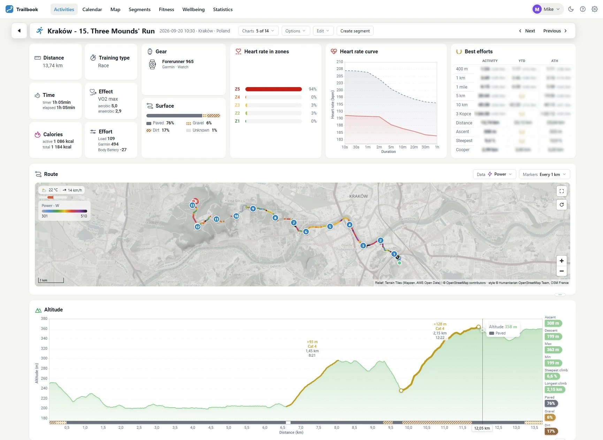</a><br><sub><em>Activity page</em></sub></p>

## Features

**Activities**
- Every activity as tiles with its route, as small charts or as a sortable table.
- 100+ sport types with their own icons; easy, tempo, intervals, hills, long or race is
  detected for each run and ride.

**Activity page**
- The route coloured by pace, heart rate, power or gradient, with the road surface of every
  stretch and the weather that helped or held you back.
- Charts linked to the map, with intervals and categorised climbs marked; the targets of a
  planned workout drawn in.
- Zones, heart rate and power curves, training effect and load, and best efforts against
  your year and all-time bests.

<table><tr><td align="center" valign="top"><a href="docs/screenshots/heart-rate.png">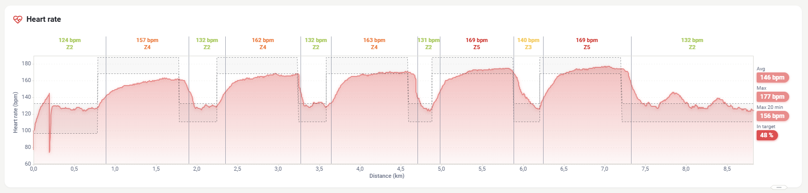</a><br><sub><em>Activity › heart rate of an interval workout</em></sub></td></tr></table>

<table><tr><td align="center" valign="top"><a href="docs/screenshots/zones.png">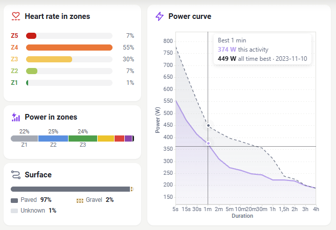</a><br><sub><em>Activity › zones, surface and power curve</em></sub></td><td align="center" valign="top"><a href="docs/screenshots/weather.png">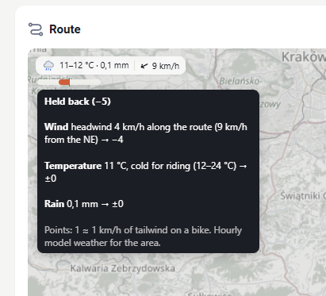</a><br><sub><em>Activity › weather on the route</em></sub></td></tr></table>

**Calendar**
- Your weeks at a glance: each day's activities, steps, stress and forecast, the week's
  totals per sport against your targets, and a year view.
- **Next workout**: what to do next, from the last 7 days, your form and a training model
  (polarized, pyramidal or threshold).
- Build structured workouts and send them to your Garmin watch through intervals.icu.

<table><tr><td align="center" valign="top"><a href="docs/screenshots/calendar.png">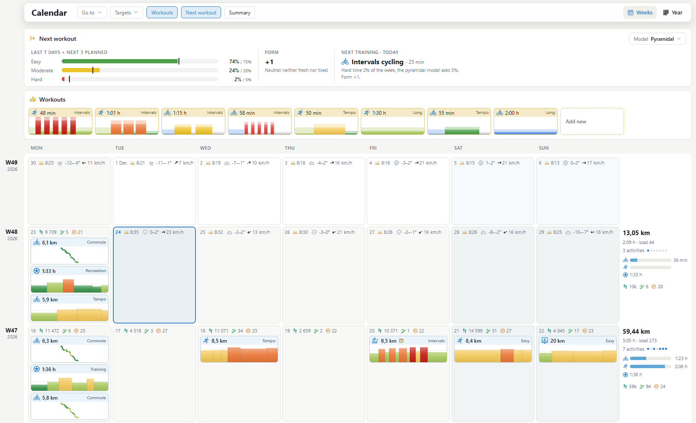</a><br><sub><em>Calendar with Next workout and workouts</em></sub></td><td align="center" valign="top"><a href="docs/screenshots/workout.png">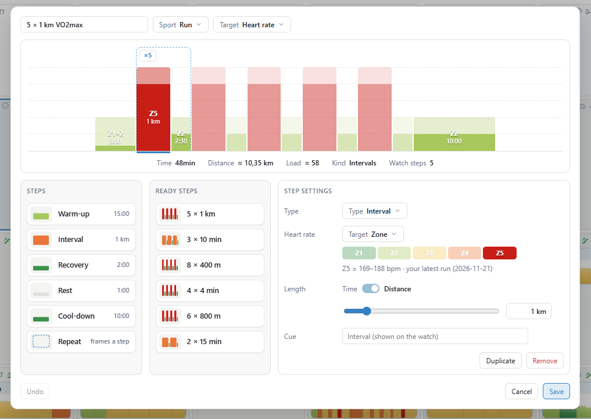</a><br><sub><em>Calendar › workout builder</em></sub></td></tr></table>

**Map**
- A heatmap of every route, per person or all together.
- Explorer tiles: every square you have visited, your biggest square and cluster, and how
  much of a region you have covered.
- Several base maps with shaded relief and marked hiking, cycling or MTB trails.

<table><tr><td align="center" valign="top"><a href="docs/screenshots/map.webp">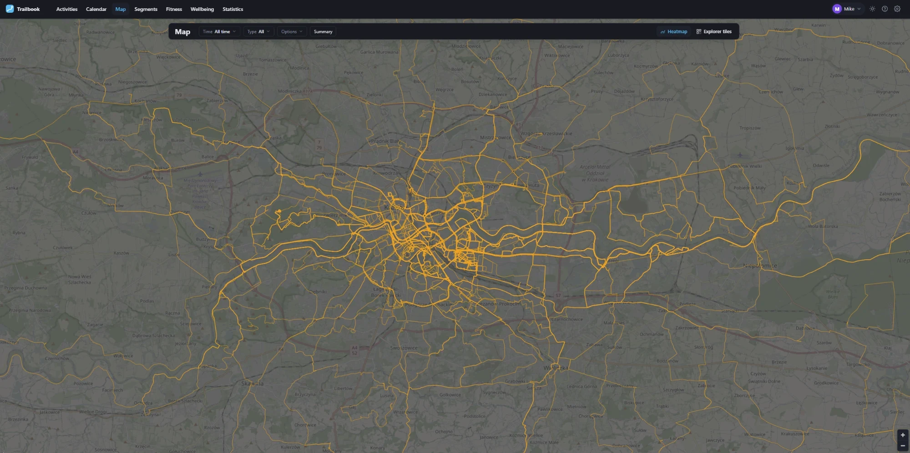</a><br><sub><em>Map › Heatmap</em></sub></td><td align="center" valign="top"><a href="docs/screenshots/tiles.webp">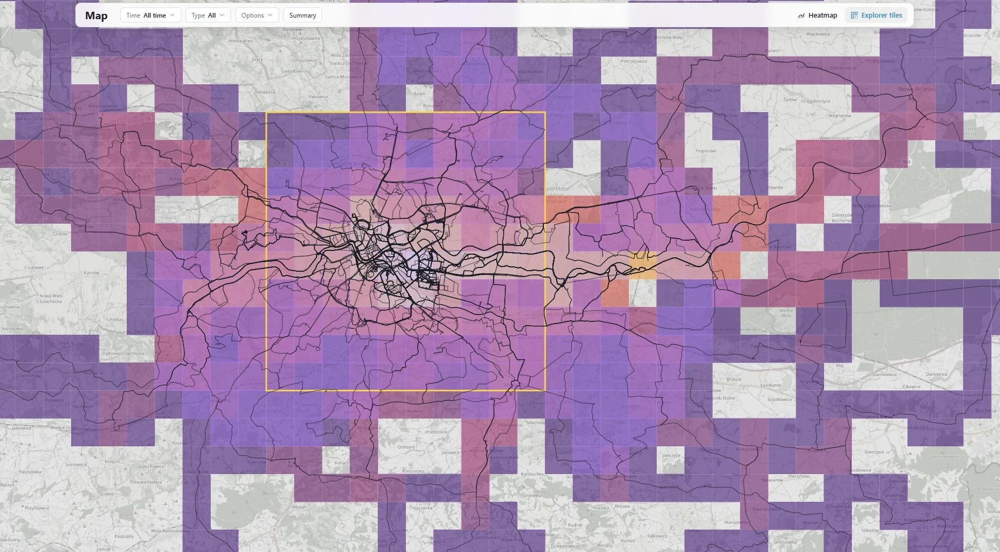</a><br><sub><em>Map › Explorer tiles</em></sub></td></tr></table>

**Segments**
- Create them from an activity or by placing pins on the map; every activity that passes is
  matched, in both directions if you like.
- Best, average and latest effort, the trend over the years and a top 10 with the weather.

<table><tr><td align="center" valign="top"><a href="docs/screenshots/segment.png">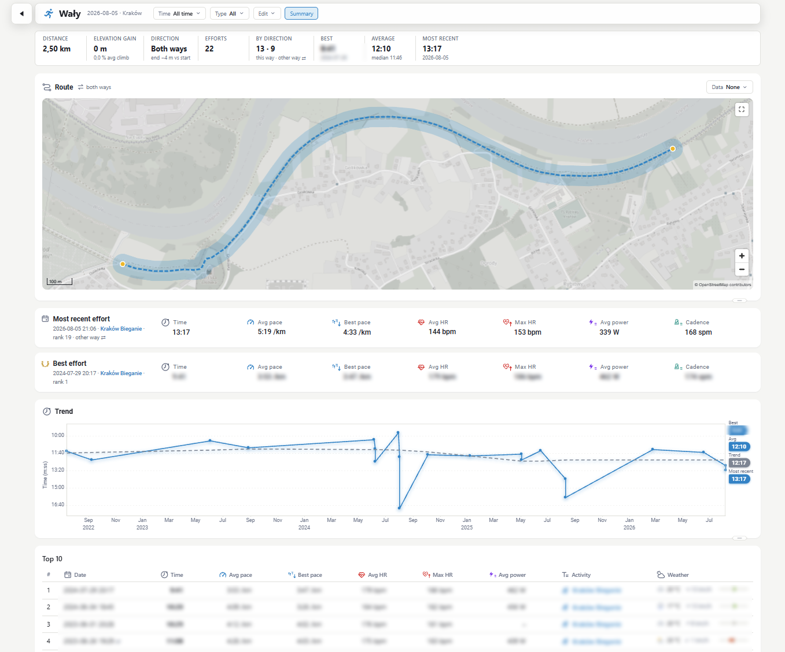</a><br><sub><em>Segment</em></sub></td></tr></table>

**Fitness**
- Training load of every activity from power, pace or heart rate.
- Fitness, fatigue and form over time, with the form zones from fresh to overreaching.

<table><tr><td align="center" valign="top"><a href="docs/screenshots/fitness.png"></a><br><sub><em>Fitness › fitness, fatigue and form</em></sub></td></tr></table>

**Statistics**
- **Compare years**: distance, activities and elevation per year, and every year as a line
  with its running total.
- **Timeline**: when, where and in what weather you train, and your explorer tiles growing.
- **Records**: your best efforts and their curves for running, cycling, walking and hiking,
  and segments, of all time or in any period.

<table><tr><td align="center" valign="top"><a href="docs/screenshots/statistics.png"></a><br><sub><em>Statistics › Compare years</em></sub></td><td align="center" valign="top"><a href="docs/screenshots/timeline.png">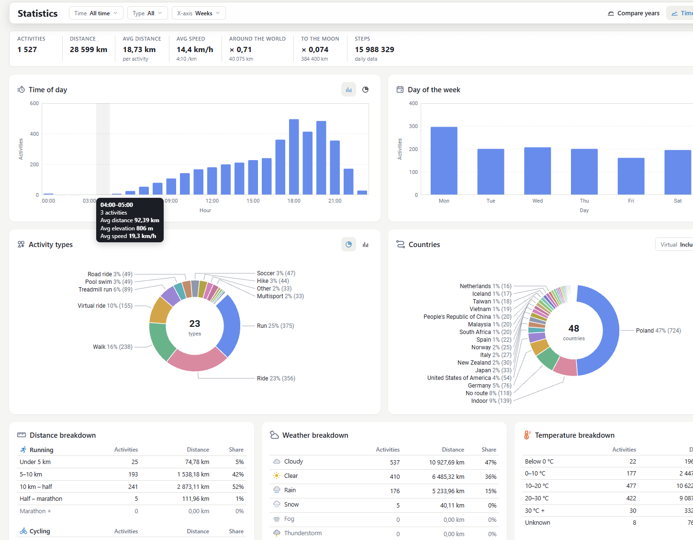</a><br><sub><em>Statistics › Timeline</em></sub></td><td align="center" valign="top"><a href="docs/screenshots/records.png">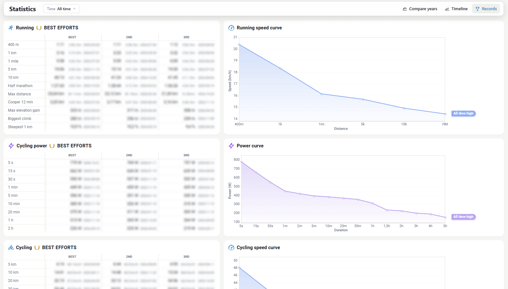</a><br><sub><em>Statistics › Records</em></sub></td></tr></table>

**And more**
- Several people in one install, and a side-by-side comparison of everyone.
- New records as Home Assistant notifications and a sensor for your dashboards.
- A built-in manual that explains every number.
- Garmin Connect as the main source: the whole history, then every new activity on its own.
- Older history from a Strava export, a folder or an upload; duplicates are skipped.
- One-click backup and move to another device.
- Light on resources: near-zero CPU when idle.
- 🚧 Wellbeing — sleep, stress, HRV and more — is coming.

## Installation

Trailbook runs in three ways; the app is the same in all of them.

- [Home Assistant app](#home-assistant-app) (recommended) — Home Assistant OS or
  Supervised.
- [Windows app](#windows-app) — one Windows PC, without Docker or Home Assistant.
- [Docker](#docker) — any other machine, also Home Assistant Container or Core (they have no
  apps).

### Home Assistant app

[](https://my.home-assistant.io/redirect/supervisor_add_addon_repository/?repository_url=https%3A%2F%2Fgithub.com%2FMD0005%2FTrailbook)

Home Assistant calls add-ons **apps** since version 2026.2; in an older version look for
*Add-ons* and *Add-on store* instead.

1. Click the button above, or in Home Assistant open **Settings › Apps › Install app**,
   click **⋮ › Repositories**, click **Add**, paste `https://github.com/MD0005/Trailbook` and
   confirm with **Add**. If Trailbook does not show up, refresh the page.
2. Find **Trailbook** in the list and click **Install**.
3. Click **Start**, then **Open web UI** (or turn on *Show in sidebar*).

- **Data:** inside the app; it is part of Home Assistant backups.
- **Updates:** Home Assistant offers them (see [Updating](#updating)).
- **Access:** through Home Assistant, with its login.

### Windows app

1. Download `Trailbook-Setup-<version>.exe` from the newest
   [release](https://github.com/MD0005/Trailbook/releases/latest) and run it. Windows may warn
   about an unknown publisher (the installer is not signed): click **More info › Run anyway**.
   No administrator rights are needed.
2. Trailbook starts in a window of its own (Microsoft Edge as an app, else your browser) at
   `http://trailbook.localhost:8099`. Its icon next to the clock opens it again or quits it.

- **Data:** `%LOCALAPPDATA%\Trailbook`. Updating keeps it; uninstalling asks whether to delete
  it too (No keeps it for a later install).
- **Updates:** **Settings › General › Updates** — one click downloads, installs and restarts.
- **Access:** this PC only. Imports and downloads run while Trailbook runs; the installer can
  start it with Windows.

### Docker

The same image runs on any machine with Docker (amd64 or arm64, e.g. a Raspberry Pi or a NAS).

1. Download [`docker-compose.yml`](docker-compose.yml).
2. Put a password next to it and start:

   ```bash
   echo "TRAILBOOK_PASSWORD=pick-a-password" > .env
   docker compose up -d
   ```

3. Open `http://<this machine>:8099`.

- **Data:** the database in `./data`; FIT files go to `./share/trailbook` (choose
  `/share/trailbook` as the watched folder); exports land in `./share/trailbook-exports`.
- **Updates:** `docker compose pull && docker compose up -d`.
- **Access:** a login with that password (log out at `/logout`). The compose file does not
  start without it; a plain `docker run` without a password has no login at all, so use that
  only if nobody else can reach the port.
- Home Assistant notifications and the records sensor are only in the Home Assistant app.

## First steps

1. **Settings › People** — add the people whose training you keep.
2. **Settings › Data** — choose **Garmin Connect** (recommended) and paste each person's
   personal API key. Old history from Strava goes in under *Other sources*.
3. Wait for the first import; progress is shown in **Settings › Imported**.
4. **Settings › People** — check the heart rate and power thresholds; training load and
   zones depend on them.

In Home Assistant the watched folder must be inside a folder the app can see: `/share` (for example
`/share/trailbook`), `/media` (read only) or the app's own config folder.

## Records in Home Assistant

When a new activity sets a record, Trailbook tells Home Assistant through one sensor,
`sensor.trailbook_records`. A record is a top-3 place of all time or of this year: the best
efforts of runs and rides (fastest 5 km, best 20 min power…), the longest distance and your
segments. Only activities from the last 14 days count, so importing old history never fires.

- Each new record is **one new state** of the sensor: the state is the record's id, `0` means
  "no new record". Each record is sent once.
- The attributes carry a ready notification: `title` (e.g. `ALL-TIME RECORD`, `2026 2ND BEST`),
  `message` (who, what, the result and the result it beat), `icon` (`mdi:trophy`,
  `mdi:medal`…) and `color`, plus the details (`person`, `activity_id`, `scope`, `rank`…).
- After a Home Assistant restart the sensor comes back as `0`, so a record is always a change
  from a number — the condition below makes sure nothing is announced twice.

Example: a notification for every new record.

```yaml
alias: Trailbook - record notification
triggers:
  - trigger: state
    entity_id: sensor.trailbook_records
    not_from: [unavailable, unknown]
    not_to: [unavailable, unknown, "0"]
conditions:
  # only a change from a number (0 or the previous record), never the sensor appearing
  - condition: template
    value_template: >-
      {{ trigger.from_state is not none and is_number(trigger.from_state.state) }}
actions:
  - action: persistent_notification.create  # or notify.mobile_app_<your phone>
    data:
      title: "{{ trigger.to_state.attributes.title }}"
      message: "{{ trigger.to_state.attributes.message }}"
mode: queued
max: 30
```

## Updating

Home Assistant shows when a new version is out (**Settings › Apps › Trailbook**); the
update dialog lists what changed ([changelog](trailbook/CHANGELOG.md)).
The database is upgraded on start. An older version cannot open a database a newer one has
upgraded, so tick *Create backup* in the update dialog if you may want to go back.

## Privacy

Your activities, routes and health data stay in Home Assistant. Trailbook only talks to the
internet for:

- map tiles (OpenStreetMap, Humanitarian, OpenTopoMap, CyclOSM, Waymarked Trails) and
  elevation tiles for the relief (Terrain Tiles on AWS Open Data),
- weather for an activity's time and place (Open-Meteo),
- road surface along a route (OpenStreetMap Overpass),
- Garmin Connect, when you connect an account.

## In development

- 🚧 **Wellbeing** — sleep, stress, HRV, resting heart rate, steps and weight from Garmin
  Connect.
- 🚧 **More sources** — further services under *Settings › Other sources*.
- 🚧 **Home Assistant automations** — start an import from an automation.

## Development

Trailbook runs on a PC without Home Assistant:

```bash
python -m venv .venv
.venv/Scripts/python -m pip install -e "backend[dev]"   # Linux/macOS: .venv/bin/...
.venv/Scripts/trailbook serve --root sample-data        # http://127.0.0.1:8099
```

Tests: `cd backend && ../.venv/Scripts/python -m pytest`. How it is built:
[specification](docs/SPEC.md); how the numbers are calculated: [manual](docs/MANUAL.md).

## Support

Trailbook is free and open source. If it helps you, you can support its development:

<a href="https://buymeacoffee.com/md0005"></a>

## Trademarks

Garmin, Garmin Connect, Body Battery and Training Effect are trademarks of Garmin Ltd. or its
subsidiaries. Strava, Home Assistant, OpenStreetMap and other names are trademarks of their
owners. They are used here only to say what Trailbook works with; Trailbook is not affiliated
with, sponsored or endorsed by any of them.

## License

[MIT](LICENSE).
Screenshots show generated demo data.
